<div align="center">

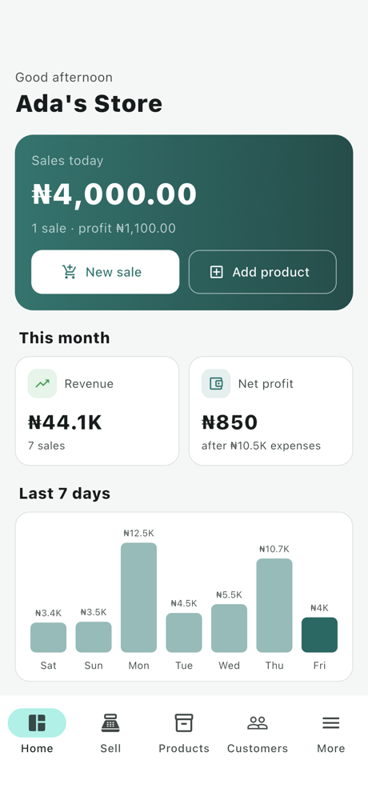

# BizDesk

**Sales, stock, customers and profit for small businesses, all in your pocket.**

A clean point-of-sale and business-management app built with Flutter. Ring up sales, print-ready receipts,
track stock with low-stock alerts, keep a customer book, log expenses and see real profit, all fully offline.


</div>

---

## Screenshots

<table>
  <tr>
    <td align="center">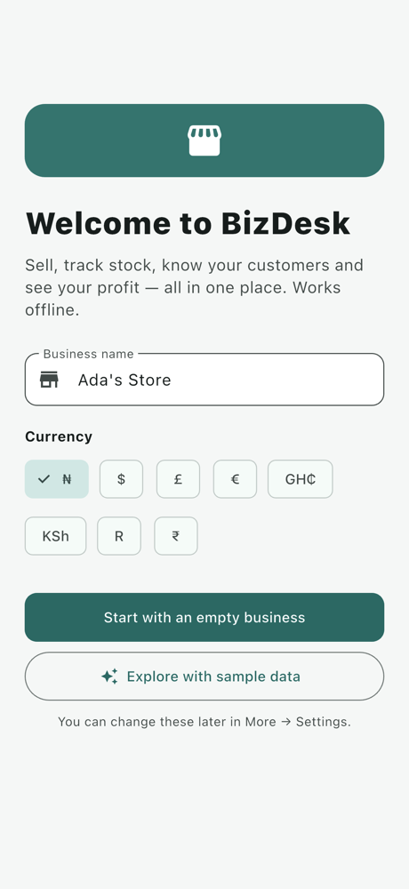<br><sub><b>Onboarding</b></sub></td>
    <td align="center"><br><sub><b>Dashboard</b></sub></td>
    <td align="center">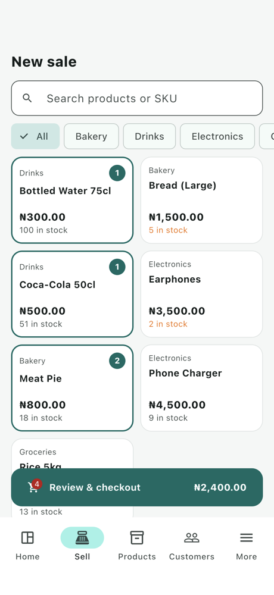<br><sub><b>Point of sale</b></sub></td>
    <td align="center">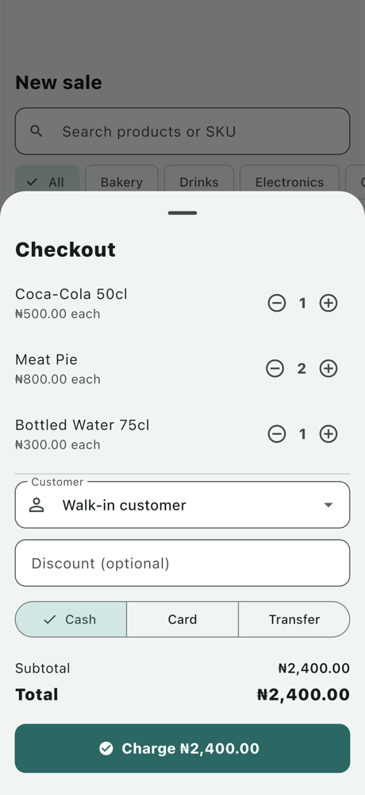<br><sub><b>Checkout</b></sub></td>
  </tr>
  <tr>
    <td align="center">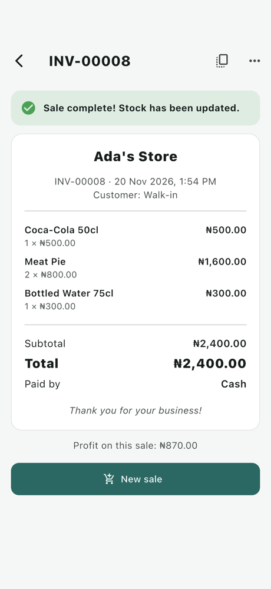<br><sub><b>Receipt</b></sub></td>
    <td align="center">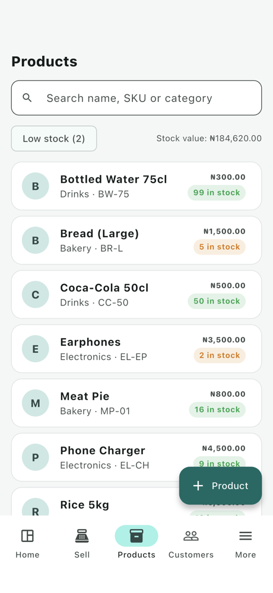<br><sub><b>Products &amp; stock</b></sub></td>
    <td align="center">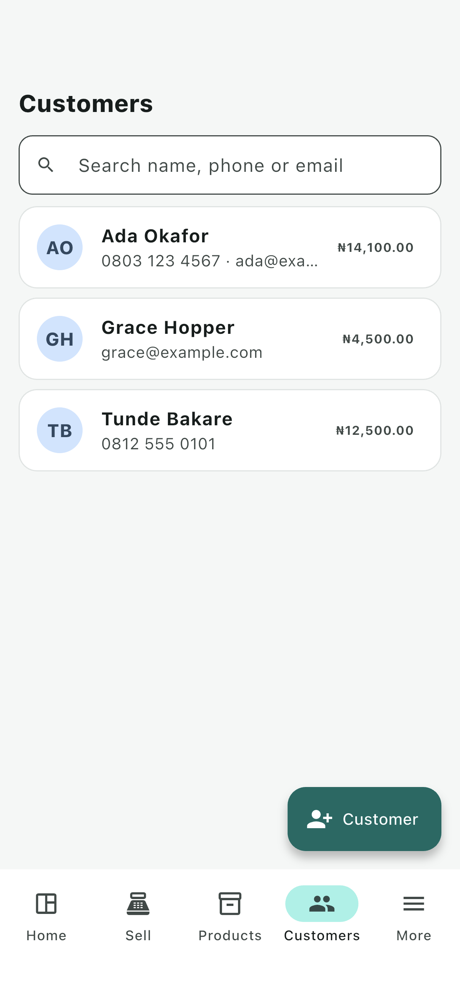<br><sub><b>Customers</b></sub></td>
    <td align="center">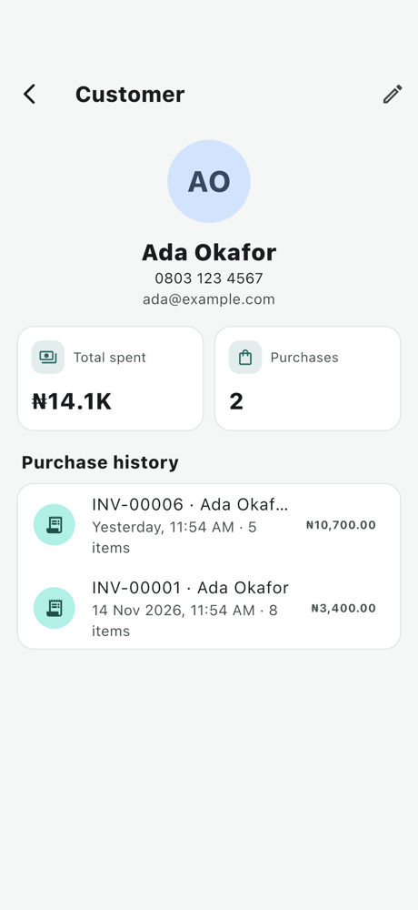<br><sub><b>Customer history</b></sub></td>
  </tr>
  <tr>
    <td align="center">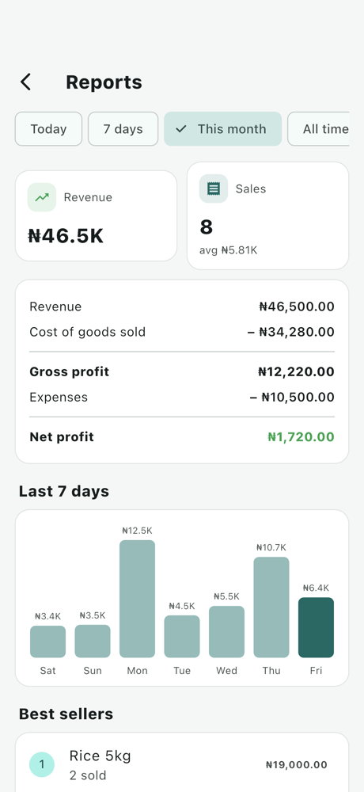<br><sub><b>Profit reports</b></sub></td>
    <td align="center">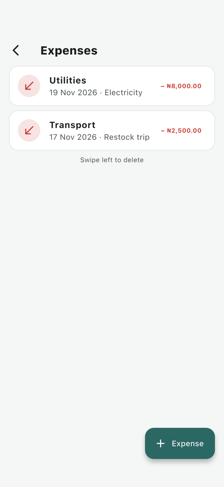<br><sub><b>Expenses</b></sub></td>
    <td align="center">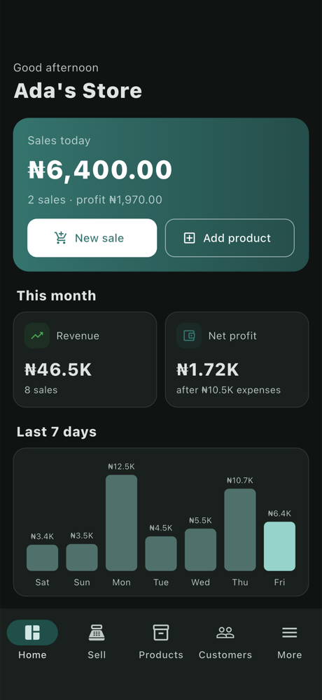<br><sub><b>Dark mode</b></sub></td>
    <td align="center">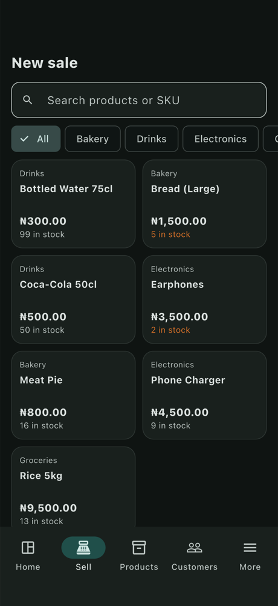<br><sub><b>Dark point of sale</b></sub></td>
  </tr>
</table>

---

## Features

| Area | What you get |
|---|---|
| **Dashboard** | Today's sales and profit, this month's revenue and net profit, a 7-day revenue chart, low-stock alerts and recent sales |
| **Point of sale** | Searchable product grid with category filters, tap-to-add cart, quantity steppers, optional customer, discount, and Cash / Card / Transfer payment |
| **Receipts** | Numbered invoices (`INV-00001` …), business name, address and footer, profit on the sale, copy-as-text to share on WhatsApp/SMS, and **void sale** (stock is restored automatically) |
| **Products & stock** | Name, SKU, category, selling price, cost price, stock level and a per-product low-stock threshold; quick restock |
| **Customers** | Contact book (phone, email, notes) with each customer's purchase history and total spent |
| **Expenses** | Log transport, utilities, rent and other costs so reports show *net* profit, not just revenue |
| **Reports** | Today / 7 days / This month / All time: revenue, cost of goods sold, gross profit, expenses, net profit, average sale and top 5 best sellers |
| **Settings** | Business name, address, phone, currency (₦, $, £, €, GH₵, KSh, R, ₹), receipt footer, load sample data, erase everything |
| **Offline & private** | All data lives on the device; no account, no network needed |
| **Light & dark** | Follows the system theme |

### Business rules worth knowing

- **Money is stored as integers in minor units** (kobo/cents), so `₦1,500.00` is `150000`. There are no floating-point rounding errors in totals or profit.
- **A sale can't oversell.** If any line asks for more than is in stock, the whole sale is rejected (`OutOfStockException`) and nothing changes.
- **Receipts are snapshots.** Each sale line copies the product's name, price and cost at sale time, so editing or deleting a product later never changes old receipts or profit figures.
- **Voiding a sale puts its items back in stock.**

---

## Getting started

### Prerequisites

- [Flutter](https://docs.flutter.dev/get-started/install) **3.47+** (Dart 3.13+)
- Xcode (for iOS) and/or Android Studio / Android SDK (for Android)

### Run it

```bash
git clone https://github.com/tejHacks/bizdesk-app.git bizdesk
cd bizdesk
flutter pub get
flutter run            # pick a simulator, emulator or connected phone
```

On first launch, enter a business name, pick a currency, and tap **Explore with sample data**.
This loads 8 products, 3 customers, a week of sales and two expenses, so every screen has something to show.
Choose **Start with an empty business** to begin from scratch instead.

### Build a release

```bash
flutter build apk --release --split-per-abi   # Android APKs in build/app/outputs/flutter-apk/
flutter build appbundle --release             # Android App Bundle for Play Store
flutter build ipa --release                   # iOS (requires signing in Xcode)
```

### Test

```bash
flutter test
```

The suite covers money parsing and formatting, stock deduction, oversell protection, voiding, receipt numbering,
low-stock detection, report maths, persistence across reloads, and a full widget test that onboards with sample data,
visits every tab on a small 360×740 phone, completes a sale and opens every *More* screen.

---

## Project structure

```
lib/
├── main.dart              # App entry: loads the store, picks onboarding or the main shell
├── store.dart             # BizStore: all data + business rules (sales, stock, reports), persisted as JSON
├── models.dart            # Product, Customer, Sale, SaleItem, Expense, BusinessSettings, Period, PaymentMethod
├── format.dart            # Money (minor units ⇄ text), dates, relative days
├── theme.dart             # Material 3 light/dark theme and brand colour
├── screens/
│   ├── onboarding.dart    # Business name, currency, sample data
│   ├── shell.dart         # Bottom navigation: Home · Sell · Products · Customers · More
│   ├── dashboard.dart     # Today, this month, 7-day chart, low stock, recent sales
│   ├── sell.dart          # Product grid, cart, checkout sheet
│   ├── receipt.dart       # Receipt view, copy as text, void sale
│   ├── products.dart      # Product list with search and stock badges
│   ├── product_form.dart  # Add / edit product, restock
│   ├── customers.dart     # Customer list, detail with history, form
│   └── more.dart          # Sales history, expenses, reports, settings
└── widgets/
    ├── charts.dart        # Lightweight bar chart (no chart package)
    └── common.dart        # Shared cards, stat tiles, empty states
test/
└── widget_test.dart       # Unit tests for the store + end-to-end widget test
```

### Architecture

- **State:** a single `BizStore` (`ChangeNotifier`) exposed through an `InheritedNotifier` (`StoreScope`). Screens call `StoreScope.of(context)` to read and rebuild, and `StoreScope.read(context)` to act.
- **Persistence:** `shared_preferences`, one JSON list per collection (`products`, `customers`, `sales`, `expenses`) plus `settings`. Corrupt data is ignored rather than crashing the app.
- **Dependencies:** only `shared_preferences` and `intl`. Charts and UI are plain Flutter widgets.

---

## Related

- **[BizDesk API](https://github.com/tejHacks/bizdesk-app-backend):** a Laravel 13 REST API and web dashboard built for BizDesk, using the same money-in-minor-units model. Use it as the base for multi-device sync.

---

## License

This project is currently unlicensed. All rights reserved by the author. Open an issue if you'd like to use it.
